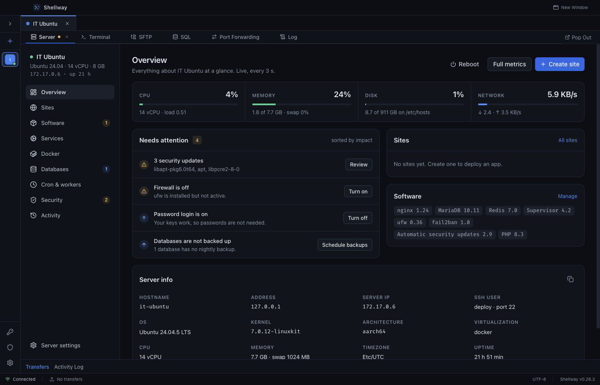
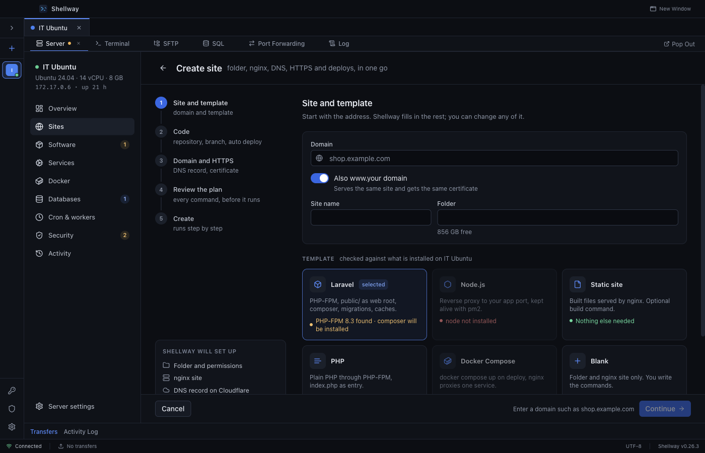
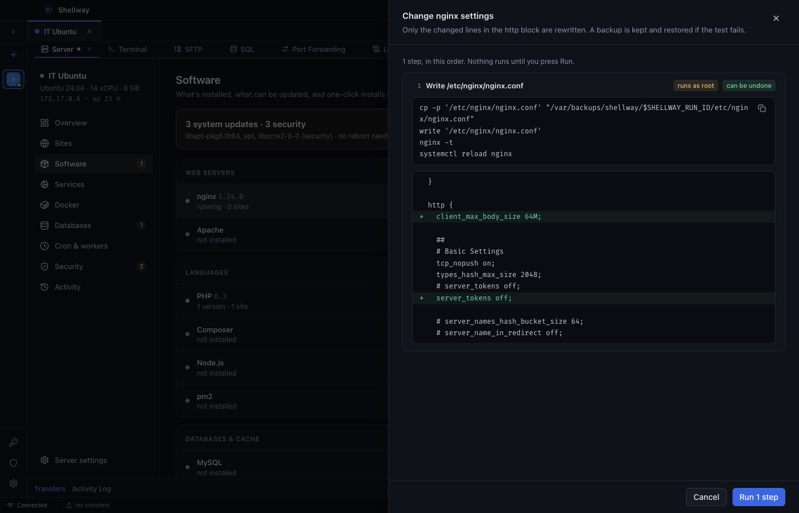
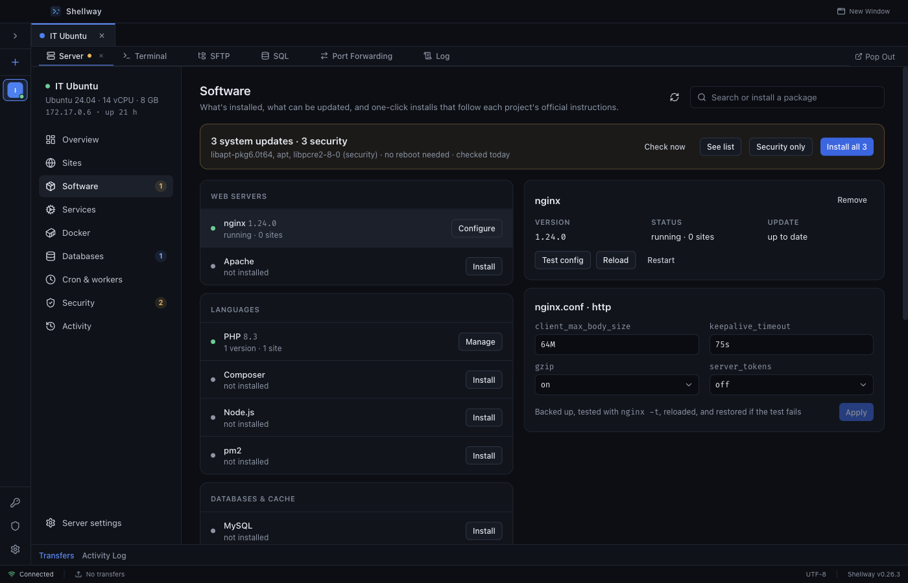
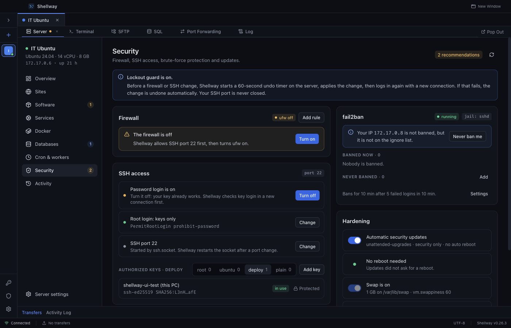
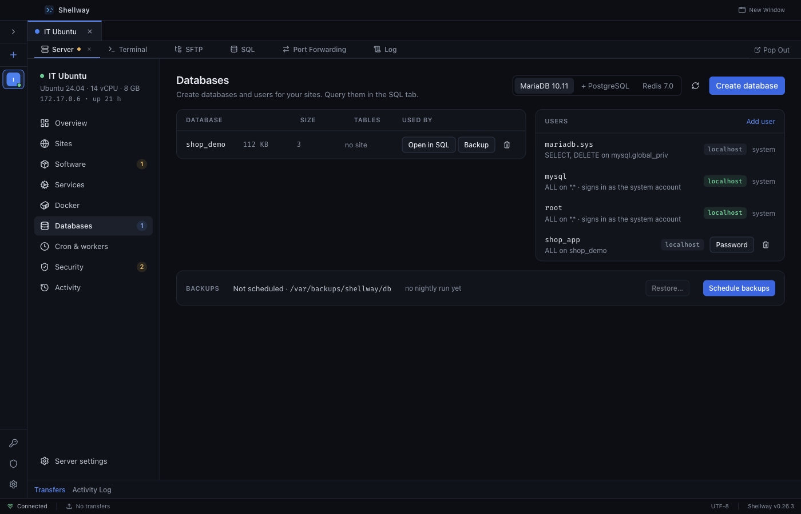
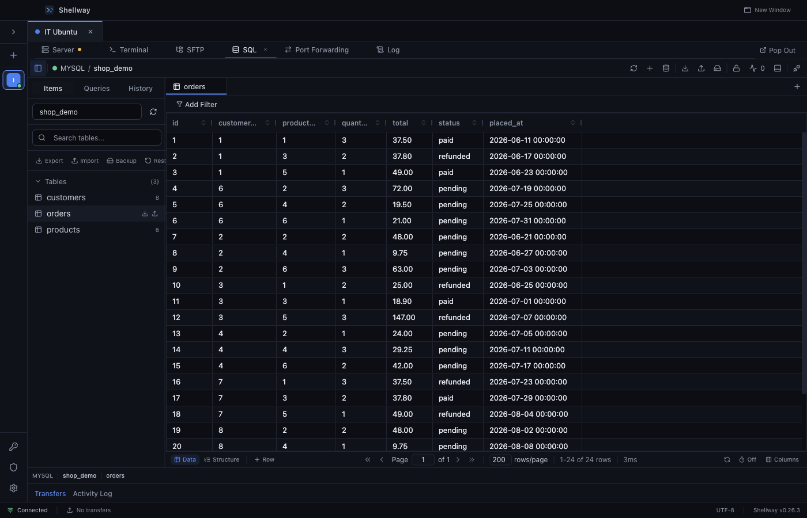
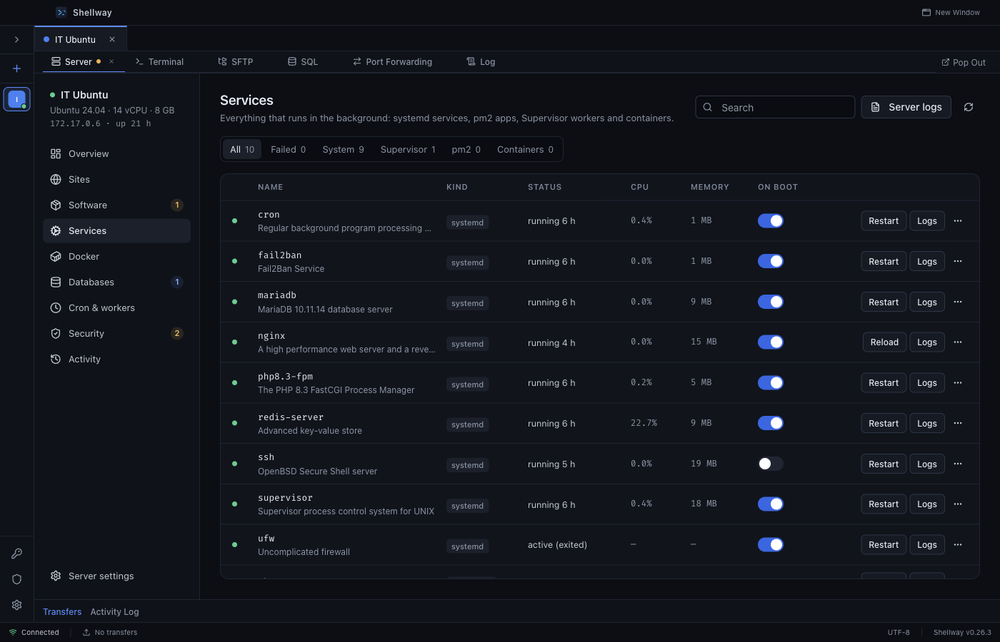
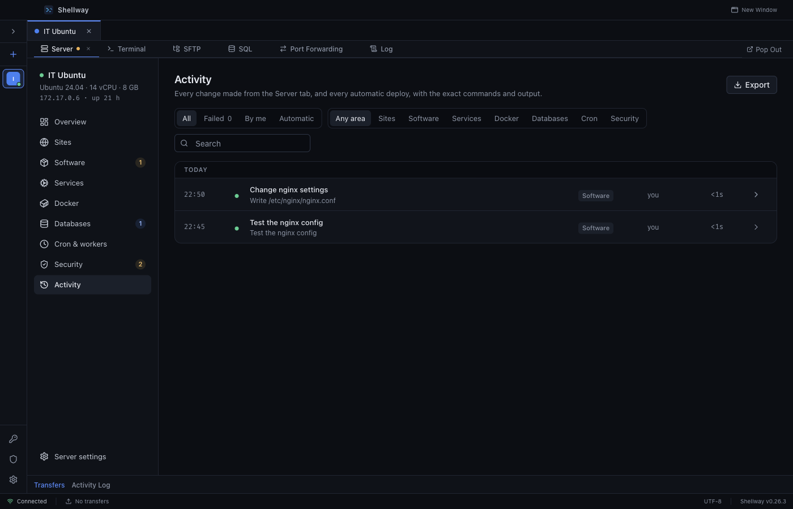

<p align="center">
  
</p>

<h1 align="center">Shellway</h1>

<p align="center">
  <b>Your terminal, your files, your databases and your whole server. One desktop app.</b>
</p>

<p align="center">
  <a href="https://github.com/WMOH-DEV/shellway/releases/latest"></a>
  <a href="LICENSE"></a>
  
  
</p>

<p align="center">
  <a href="#download">Download</a> ·
  <a href="#what-you-can-do">Features</a> ·
  <a href="#screenshots">Screenshots</a> ·
  <a href="#build-from-source">Build</a> ·
  <a href="#contributing">Contributing</a>
</p>

<p align="center">
  
</p>

---

## What is Shellway?

Shellway is a free desktop app for people who run their own Linux servers. It starts where a normal SSH client stops.

You get a fast terminal, a two-pane file manager and a real SQL client, all over your existing SSH connection. Then there is the **Server tab**. Connect to a plain Ubuntu or Debian box and Shellway shows you what is running, what needs attention and what you can fix with one click: sites, deploys, HTTPS certificates, PHP, nginx, databases, backups, cron jobs, workers, the firewall and SSH security.

Think of the convenience of a hosted control panel, minus the agent on your server, the monthly bill and the lock-in. Shellway only talks SSH. Close the app and your server is exactly as you left it.

### Who it is for

- **Developers who deploy their own apps.** Laravel, PHP, Node.js, static sites or Docker Compose on a VPS you control.
- **Freelancers and small teams** looking after a handful of client servers without paying per server.
- **Anyone who lives in SSH** and is tired of juggling a terminal, an SFTP client, a database GUI and a browser tab of notes.

### Why people pick it

- **See before you run.** Every change on the server opens a review panel with the exact commands and a diff of every file. Nothing runs until you press Run.
- **Hard to break things.** Config edits are backed up, tested and reloaded. If the test fails, the old file comes back on its own. Firewall and SSH changes run under a 60 second undo timer, so a bad rule cannot lock you out.
- **No agent, no account.** Nothing is installed on your server except a small deploy script, and only if you use deploys. Your passwords and keys stay encrypted on your computer.
- **One window for the whole job.** Open a terminal next to the site you are fixing, pop any tool out into its own window, and query the database without another app.

---

## What you can do

### Manage the server

| Section | What it gives you |
| --- | --- |
| **Overview** | Live CPU, memory, disk and network. One ranked list of what needs you: security updates, a stopped service, a firewall that is off, databases with no backup. Each item has a button that fixes it. |
| **Sites** | Create a site in one flow: folder, nginx or Apache, PHP version, database, DNS on Cloudflare, an HTTPS certificate and deploys from Git. Each site gets deploys with history, an environment editor, workers, logs and domain management. |
| **Software** | System updates with a security-only option. Install and remove nginx, Apache, PHP, Composer, Node.js, pm2, MySQL, MariaDB, PostgreSQL, Redis, Docker, certbot, Supervisor, ufw and fail2ban. Manage PHP versions, extensions and php.ini. Tune nginx (upload size, keepalive, gzip, hide the version). Search and install any apt package. |
| **Services** | Every systemd service, Supervisor program, pm2 app and container in one list, with CPU, memory, start on boot, restart and logs. A failed service shows its last log lines and, when the cause is known, a one-click fix. |
| **Docker** | Containers, images and Compose stacks. Run an image and put it on a domain with HTTPS in the same step. |
| **Databases** | Create databases and users for MySQL, MariaDB and PostgreSQL. Nightly backups with retention, restore, and one click to open a database in the SQL client. |
| **Cron & workers** | Scheduled tasks with a readable schedule builder and logs. Long-running workers kept alive by Supervisor or pm2. |
| **Security** | Firewall rules (ufw), fail2ban bans and your own never-ban list, SSH keys per user, password and root login, the SSH port, automatic security updates and swap. |
| **Activity** | A history of every change made from Shellway, with the commands and their output. Export it any time. |
| **Notifications** | Get a Slack, Discord or webhook message when a deploy fails, a certificate is at risk, a service stops or the server needs a reboot. |

Server management works on Ubuntu and Debian today.

### Work on the server

- **Terminal.** Fast xterm.js terminal with tabs, search, split view and saved command snippets with abbreviations and a quick palette.
- **SFTP file manager.** Two panes, drag and drop, a transfer queue with pause and resume, conflict handling, bandwidth limits and a built-in editor for remote files.
- **Port forwarding.** Local, remote and dynamic (SOCKS) tunnels that can start on connect.
- **System monitor.** Per-core CPU, memory, network, disk I/O and a sortable process list.

### Query your databases

- MySQL, MariaDB and PostgreSQL over an SSH tunnel, or connect directly.
- A fast data grid with inline editing, change review and all-or-nothing saves.
- Filters (match all or any), multi-column sort, JSON cell viewer, table structure editing with a DDL preview.
- A query editor with autocomplete, formatting, EXPLAIN, per-query timeouts and explicit transactions.
- **Safe mode** for production connections: risky statements ask before they run.
- Query history and a saved query library per connection.
- Import, export, backup and restore, with an import that detects and helps fix common errors in a dump.

### Everything around it

- **Sessions.** Groups, colors, notes, per-session overrides, startup commands, import and export (secrets are stripped).
- **Every way to log in.** Password, public key, key plus password, keyboard-interactive, GSSAPI/Kerberos and agent forwarding. SOCKS4, SOCKS5 and HTTP proxies.
- **Host key checks** on first connect and when a key changes, with a manager for trusted keys.
- **Automatic reconnect** with backoff you control.
- **Multi-window.** Pop any tool out into its own window and split panes side by side.
- **Auto-update** from GitHub Releases.

---

## Screenshots

<table>
  <tr>
    <td width="50%"><p align="center"><sub>Create a site: folder, web server, DNS, HTTPS and deploys</sub></p></td>
    <td width="50%"><p align="center"><sub>Every change shows its commands and diff before it runs</sub></p></td>
  </tr>
  <tr>
    <td><p align="center"><sub>Software catalog and nginx settings</sub></p></td>
    <td><p align="center"><sub>Firewall, fail2ban, SSH and hardening with a lockout guard</sub></p></td>
  </tr>
  <tr>
    <td><p align="center"><sub>Databases, users and backups</sub></p></td>
    <td><p align="center"><sub>SQL client over the same SSH connection</sub></p></td>
  </tr>
  <tr>
    <td><p align="center"><sub>Services, workers and containers in one list</sub></p></td>
    <td><p align="center"><sub>Every change is recorded with its output</sub></p></td>
  </tr>
</table>

<sub>All screenshots were taken against a throwaway Docker test server with demo data.</sub>

---

## How Shellway keeps your server safe

Shellway was built to be used on production servers, so the rules are strict:

1. **Nothing runs without review.** Each action builds a plan in the app's main process. You see every command, which ones need root and a diff of each file before you press Run.
2. **Config edits can undo themselves.** Shellway backs up the file, writes the new one, runs the right test (for example `nginx -t` or `php-fpm -t`) and reloads the service. If any step fails, the backup is restored. If the file changed on the server since you reviewed it, the run stops and asks you to review again.
3. **No lockouts.** Before a firewall or SSH change, Shellway starts a 60 second undo timer on the server, applies the change, then logs in again over a fresh connection. If that login fails, the change is undone automatically. Your SSH port is never closed.
4. **No stored sudo password.** Changes run with `sudo -n`, which never prompts. If your user needs a password for sudo, Shellway tells you how to allow it for the commands it needs.
5. **No hammering.** One run per click and no retry loops, so a protected server (fail2ban and friends) is never flooded.
6. **Your secrets stay local.** Passwords, passphrases and keys are encrypted at rest with AES-256-GCM. The window runs sandboxed with context isolation, and exported sessions never include secrets.

---

## Download

Get the latest version from **[GitHub Releases](https://github.com/WMOH-DEV/shellway/releases/latest)**:

| Platform | File |
| --- | --- |
| macOS (Apple silicon and Intel) | `.dmg` |
| Windows (64-bit) | `-setup.exe` |
| Linux (64-bit) | `.AppImage` (needs `libfuse2`) |

Shellway updates itself when a new release is out.

### Quick start

1. Click **+** in the sidebar and add your server (host, user, and a key or password).
2. Connect. The **Server** tab scans the machine and shows the Overview.
3. Fix what is listed under **Needs attention**, or open **Sites › Create site** to put your first app online.

---

## Build from source

You need **Node.js 18 or newer** and npm. On macOS install the Xcode command line tools (`xcode-select --install`). On Linux install `build-essential` and `libsecret-1-dev`.

```bash
git clone https://github.com/WMOH-DEV/shellway.git
cd shellway
npm install
npm run dev
```

| Command | What it does |
| --- | --- |
| `npm run dev` | Start the app with hot reload |
| `npm run build` | Production build into `out/` |
| `npm run typecheck` | Type check the main and renderer code |
| `npm test` | Run the unit and component tests (Vitest) |
| `npm run dist:mac` | Build the macOS `.dmg` (run on a Mac) |
| `npm run dist:win` | Build the Windows installer |
| `npm run build && npx electron-builder --linux` | Build the Linux AppImage |

Installers are written to `dist/`.

### Tech stack

Electron, electron-vite and electron-builder · React 18 and TypeScript · Zustand · Tailwind CSS · xterm.js · ssh2 · Monaco Editor · AG Grid · Vitest.

### How the code is organized

```
electron/          Main process: SSH, SFTP, SQL, the server action engine, IPC, windows
  ipc/             IPC handlers, one file per feature
  services/        Long-lived services (SSH, transfers, server scans, actions, deploys)
  preload.ts       The typed API the window is allowed to call
src/               Renderer (React)
  components/      UI by feature: server, sql, sftp, terminal, deploy, ssl, settings, ui
  stores/          Zustand stores
  utils/server/    Server tab logic: probes, action plans, parsers (pure and unit tested)
resources/         Icons and the scripts Shellway places on a server
docs/screenshots/  Images used in this README
```

Server features follow one pattern. A **probe** reads facts from the server, an **action** turns your request into a reviewed plan of steps, and the **action engine** in the main process runs that plan. The window never sends shell commands of its own.

---

## Keyboard shortcuts

These are the defaults. Change any of them in **Settings › Shortcuts**.

| Shortcut | Action |
| --- | --- |
| `Cmd/Ctrl + Shift + T` | New terminal tab |
| `Cmd/Ctrl + Shift + F` | Switch to SFTP |
| `Cmd/Ctrl + Shift + D` | Switch to SQL |
| `Cmd/Ctrl + Shift + B` | Toggle split view |
| `Cmd/Ctrl + Alt + N` | New window |
| `Cmd/Ctrl + Shift + S` | Snippet palette (terminal) |
| `Cmd/Ctrl + Enter` | Run query (SQL) |
| `Cmd/Ctrl + S` | Save staged changes (SQL) |
| `Cmd/Ctrl + Shift + N` | New query tab (SQL) |
| `F5` | Refresh data (SQL) |

---

## Contributing

Contributions are welcome, from typo fixes to new server features.

**Found a bug or have an idea?** [Open an issue](https://github.com/WMOH-DEV/shellway/issues) with your OS, the Shellway version (Settings › About) and the steps to reproduce it. Screenshots help a lot.

**Found a security problem?** Please do not open a public issue. Report it privately through [GitHub security advisories](https://github.com/WMOH-DEV/shellway/security/advisories/new) or by email to owner@waelzone.com.

### Sending a pull request

1. Fork the repository and create a branch from `main` (`feat/short-name` or `fix/short-name`).
2. Make your change and add or update tests next to the code you touched.
3. Run the checks before you push:
   ```bash
   npm run typecheck
   npm test
   ```
4. Use [Conventional Commits](https://www.conventionalcommits.org/) for messages, for example `fix(sftp): keep timestamps on upload`.
5. Open the pull request with a short description of what changed and why. Add a screenshot for anything visible.

### House rules

- **Never test against a real server.** Server features are tested with pure unit tests and with throwaway Docker containers (see `electron/integration/`). Do not point tests or debugging sessions at production machines.
- **Server changes go through the action engine.** New features add a probe and an action with a plan the user reviews. No hidden commands, no retry loops, `sudo -n` only.
- **Keep it simple and readable.** Small functions, clear names, no speculative abstractions.
- **No comments in client code.** Code that ships in the app (`src/`) should explain itself through naming. Shipped code can be read by anyone, so never put secrets or security details in strings or comments.
- **Plain language in the UI.** Short sentences a busy person can act on.

By contributing you agree that your contribution is licensed under the Apache License 2.0, like the rest of the project.

---

## License and credit

Shellway is open source under the **[Apache License 2.0](LICENSE)**.

You are free to use, change and share it, including commercially. If you redistribute Shellway or build something on it, the license requires you to:

- keep the [`LICENSE`](LICENSE) and [`NOTICE`](NOTICE) files with your copy, and
- keep the credit to the original author, as written in `NOTICE`.

A visible line such as *"Based on [Shellway](https://github.com/WMOH-DEV/shellway) by Wael Mohamed Essaid"* in your README or About screen is the easiest way to do that.

Versions up to and including 0.26.3 were released under the MIT License.

---

## Author

Created and maintained by **Wael Mohamed Essaid**.

[waelzone.com](https://waelzone.com) · [GitHub](https://github.com/WMOH-DEV)

If Shellway saves you time, a star on GitHub helps other people find it.
